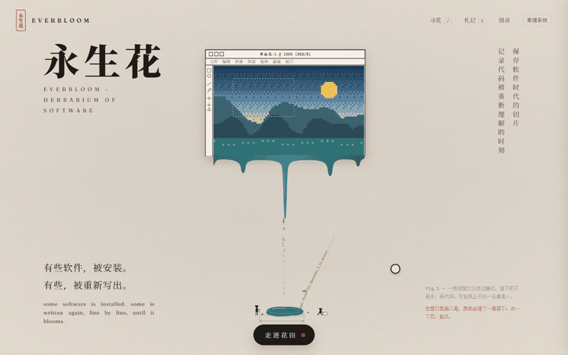
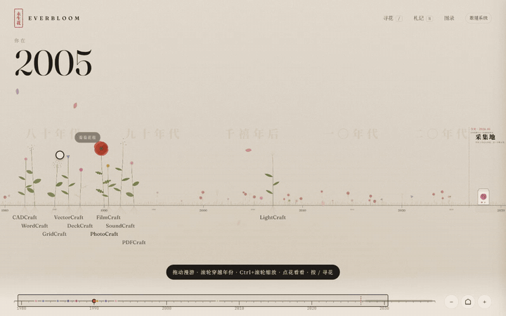
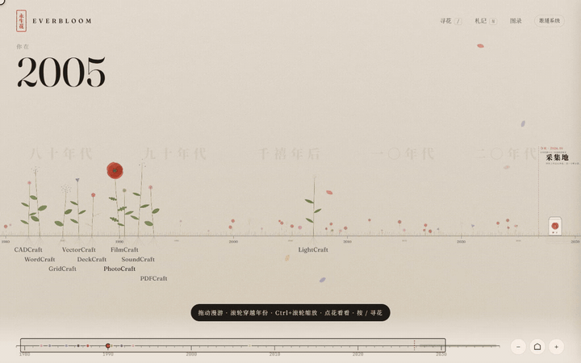
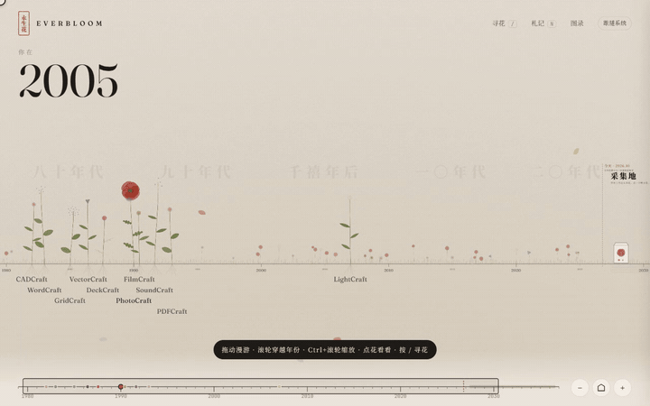
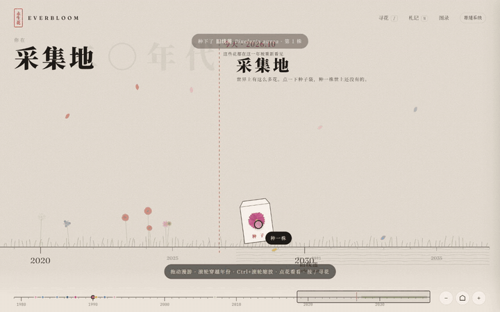
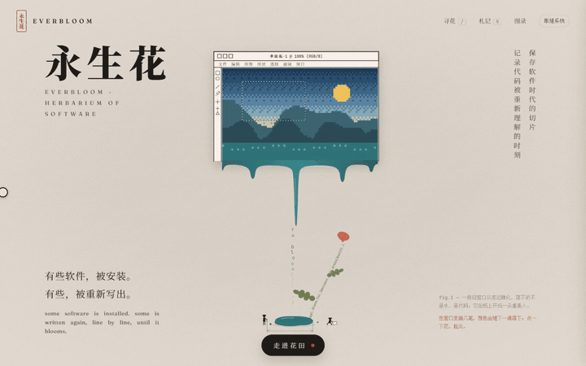
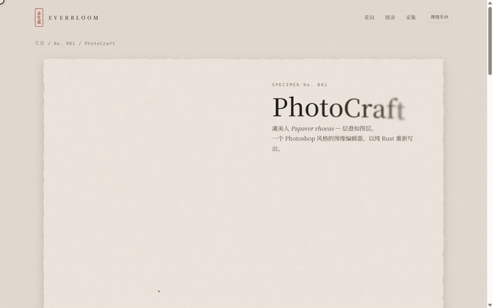
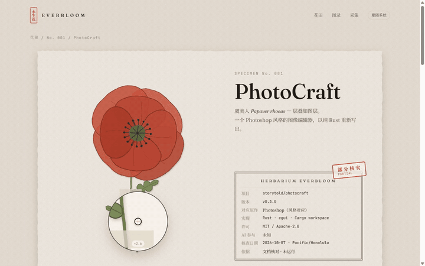

# 永生花 · Everbloom


> 保存软件时代的切片，记录代码被重新理解的时刻。

**[走进花田 →](https://qiuner.github.io/everbloom/)**　·　[图录（线性阅读）](https://qiuner.github.io/everbloom/read.html)　·　[标本 No.001 PhotoCraft](https://qiuner.github.io/everbloom/specimen.html)

永生花的名字，来自把花压成标本、永葆其美的做法。软件承载一个时代的知识和工作方式。从前，它们封在安装包里；如今，有人用开源的方式把它们一行一行重新写出来。

这个仓库收集经典软件的**开源重实现**、兼容项目和公开技术研究，记录来源、实现方式、体积与成熟度，并把"作者声称"和"我们核验到的"分开写。

> **边界**：本仓库不存放破解程序、补丁、序列号、密钥、下载链接或绕过授权的操作步骤。独立实现相似行为、恢复内部逻辑、取得源代码、绕过授权，分别记录，不能互相推导。

当前阶段：记录理念、收集数据，并以静态原型探索网站的视觉与交互。站点由 [`prototype/`](prototype/) 经 GitHub Actions 自动部署到 GitHub Pages。

---

## 走进花田

网站不往下翻页。它是一片可以漫游的花田：**横轴是时间的土壤**，每个重实现项目是一株花，种在它对应的原作首次发布的那一年。

### 穿过窗口

开场之后点"走进花田"，或者继续滚动。入口画面像被穿过一样放大、淡去，镜头从虞美人的花心一路拉远，露出整片花田。



### 在时间里散步

拖动漫游；**滚轮不翻页，而是在年份间穿越**；Ctrl + 滚轮或双指捏合缩放。左上角写着"你在 1990 年"，越往早年走，纸面越泛黄。

缩放分三层：远看时，名字像图例一样排在土壤下面；中景时，名字挂在花下，互相避让；近景时，点开的那株会出现标签卡片。**盛开的花已经压制成标本**，**花苞是还没核查的线索**，光标停上去它才慢慢打开。



### 点一下，再点一下

第一次点花，镜头飞过去，其他花退成背景，卡片上写着核查状态；再点一次，或者点"翻开标本"，卡片会变成整张台纸。



### 寻花与札记

按 `/` 寻一株花，输入名字、原作、年份或花种都可以，回车后镜头飞过去。按 `N` 打开札记，里面有序言、怎么读这片花田、两种墨水和边界说明。



### 采集地与入口里的小游戏

| 采集地：世界上有这么多花 | 入口：在窗口里作画、点花起风 |
| --- | --- |
|  |  |
| 时间线的尽头是采集地。点种子袋，就会长出一株世上还没有的花，带拉丁名和中文名。种过的花留在你自己的浏览器里。 | 在开场的像素窗口里画几笔，颜色会随下一滴水落下，把水洼染色。点一下虞美人会起风。 |

### 标本页

| 压制与放大镜 | 成熟度之花 |
| --- | --- |
|  |  |
| 打开时，花从茎到瓣重新压一遍，胶带贴下，印章盖上。移动指针可以用放大镜细看。 | 自评表的每一项是一片花瓣：盛开代表完成、半透明代表部分完成、只有轮廓代表缺失。外圈 133 粒种子对应 133 个设置，空心的 60 粒是"尚未发芽"。 |

### 操作速查

| 操作 | 作用 |
| --- | --- |
| 拖动 / 单指滑动 | 漫游，松手有惯性 |
| 滚轮 | 在年份间穿越 |
| Ctrl + 滚轮 / 双指捏合 / 双击 | 缩放 |
| 点花 · 再点一次 | 聚焦 · 打开标本（花苞会打开源仓库） |
| `[` `]` | 在花之间按年份跳 |
| `/` | 寻花 |
| `N` | 札记 |
| `0` | 回到全景 |
| `Esc` | 返回 |
| 底部年代尺 | 拖动穿越年份，同时也是小地图 |

系统开启"减少动态效果"时，所有动画退化为静态画面，只保留作画、种花这类由你主动触发的交互。网站同时提供[图录](https://qiuner.github.io/everbloom/read.html)版本，适合一口气读完。

---

## 标本册

| No. | 项目 | 对应原作（首次发布） | 花种 | 状态 |
| --- | --- | --- | --- | --- |
| 001 | [PhotoCraft](https://github.com/storytold/photocraft) | Photoshop（1990） | 虞美人 | 部分核实：文档核对，未运行 |
| 002 | [FilmCraft](https://github.com/storytold/filmcraft) | Premiere Pro（1991） | 向日葵 | 待采集 |
| 003 | [VectorCraft](https://github.com/storytold/vectorcraft) | Illustrator（1987） | 鸢尾 | 待采集 |
| 004 | [LightCraft](https://github.com/storytold/lightcraft) | Lightroom（2007） | 昙花 | 待采集 |
| 005 | [PDFCraft](https://github.com/storytold/pdfcraft) | Acrobat（1993） | 山茶 | 待采集 |
| 006 | [WordCraft](https://github.com/storytold/wordcraft) | Word（1983） | 勿忘我 | 待采集 |
| 007 | [SoundCraft](https://github.com/storytold/soundcraft) | Pro Tools（1991） | 风铃草 | 待采集 |
| 008 | [CADCraft](https://github.com/storytold/cadcraft) | AutoCAD 风格工作流（1982） | 莲 | 待采集 |
| 009 | [DeckCraft](https://github.com/storytold/deckcraft) | PowerPoint（1987） | 波斯菊 | 待采集 |
| 010 | [GridCraft](https://github.com/storytold/gridcraft) | Excel 风格工作流（1985） | 绣球 | 待采集 |

"对应原作"来自各项目作者的描述，不代表功能等价。原作年份是公开常识，只用来在时间轴上定位。花种是为每个项目选的意象，花的高度和位置只为构图，不编码数据。待采集项目的线索来源见 [`LEADS.md`](LEADS.md)。

## 首个标本：PhotoCraft

项目：[storytold/photocraft](https://github.com/storytold/photocraft)。

- 定位：作者称其为基于公开规格与可观察行为、用纯 Rust 独立实现的 Photoshop 风格图像编辑器；许可证为 MIT / Apache-2.0。这是项目声明，未独立审计其 clean-room 过程。
- 技术：Cargo 工作区包括 PSD、文档、画笔、合成、GPU、自动化及 egui UI 等模块。README 描述了图层、蒙版、调整层、PSD 读写和 CLI / MCP 控制能力。
- 体积：核查时最新发布为 v0.3.0。Web ZIP 为 11,119,388 字节（11.12 MB）；Windows x64 MSI 为 53,895,168 字节（53.90 MB），便携 ZIP 为 65,251,740 字节（65.25 MB）。这些是发布附件大小，不是安装后体积。
- 成熟度：README 明确标注 early alpha，尚不能替代日常专业工作中的 Photoshop。v0.3.0 自评表列出工具项完成 3、部分完成 14、缺失 13，以及 133 个设置中 60 个尚无效果。菜单接通不等于功能完整。
- 判断：现有材料支持“开源重实现项目”的描述，不能据此推断 Adobe 源码被破解或泄露，也不能认定与 Photoshop 完全等价。
- 核验范围：2026-10-07（Pacific/Honolulu）读取 GitHub README、发布附件元数据、v0.3.0 Cargo.toml 和自评表摘要；未安装、编译或运行测试，未定位 X 原帖，未核实 AI 生成代码的比例。

证据：[v0.3.0 发布页](https://github.com/storytold/photocraft/releases/tag/v0.3.0) · [自评表](https://github.com/storytold/photocraft/blob/v0.3.0/docs/scorecard.md) · [Cargo.toml](https://github.com/storytold/photocraft/blob/v0.3.0/Cargo.toml)

## 记录原则

- 只引用公开可访问的原帖、新闻或厂商公告。
- 将“公开声称”与“已验证事实”分开记录。网站上，作者声明用铅笔色，核验所见用墨色。
- 不下载、运行或传播来历不明的软件包。
- 优先记录软件版本、发布日期、原帖时间、作者、证据类型和风险。
- 对涉及未授权复制或分发的内容，使用官方购买渠道或免费替代品作为参考。

## 条目状态

- `unverified`：仅有公开说法，尚未核验。
- `partially-verified`：部分证据可核验，但无法确认完整性或真实性。
- `verified`：有可信的独立证据支持，仍不代表授权分发合法。
- `retracted`：原作者撤回、帖子删除或事实被反驳。

核查状态只表示检查了哪些范围，不为项目的真实性或安全性作担保。

## 目录

- [`PHILOSOPHY.md`](PHILOSOPHY.md)：理念、收录范围、视觉方向，以及 SEO/GEO 的后续设想。
- [`LEADS.md`](LEADS.md)：从公开来源发现的待核查项目。
- [`claims.csv`](claims.csv)：结构化索引。
- [`CONTRIBUTING.md`](CONTRIBUTING.md)：提交记录的格式和安全边界。
- [`prototype/`](prototype/)：网站。
  - `index.html`：入口与花田；`read.html`：图录；`specimen.html`：PhotoCraft 标本页。
  - `assets/everbloom.js`：花种与压花绘制；`assets/motion.js`：动效；`assets/field.js`：花田的镜头、输入与界面。
- [`docs/media/`](docs/media/)：README 里的动图。

## 本地预览

网站是纯静态页面，不需要构建，也没有依赖。花朵、纸张、印章都由 SVG 和 CSS 现场绘制，字体来自 Google Fonts。

```bash
node .claude/serve.mjs prototype 4173
```

然后打开 <http://localhost:4173>。

## 参与

欢迎提交线索或核查记录，格式和边界见 [`CONTRIBUTING.md`](CONTRIBUTING.md)。只接受公开来源和可审计的证据。
